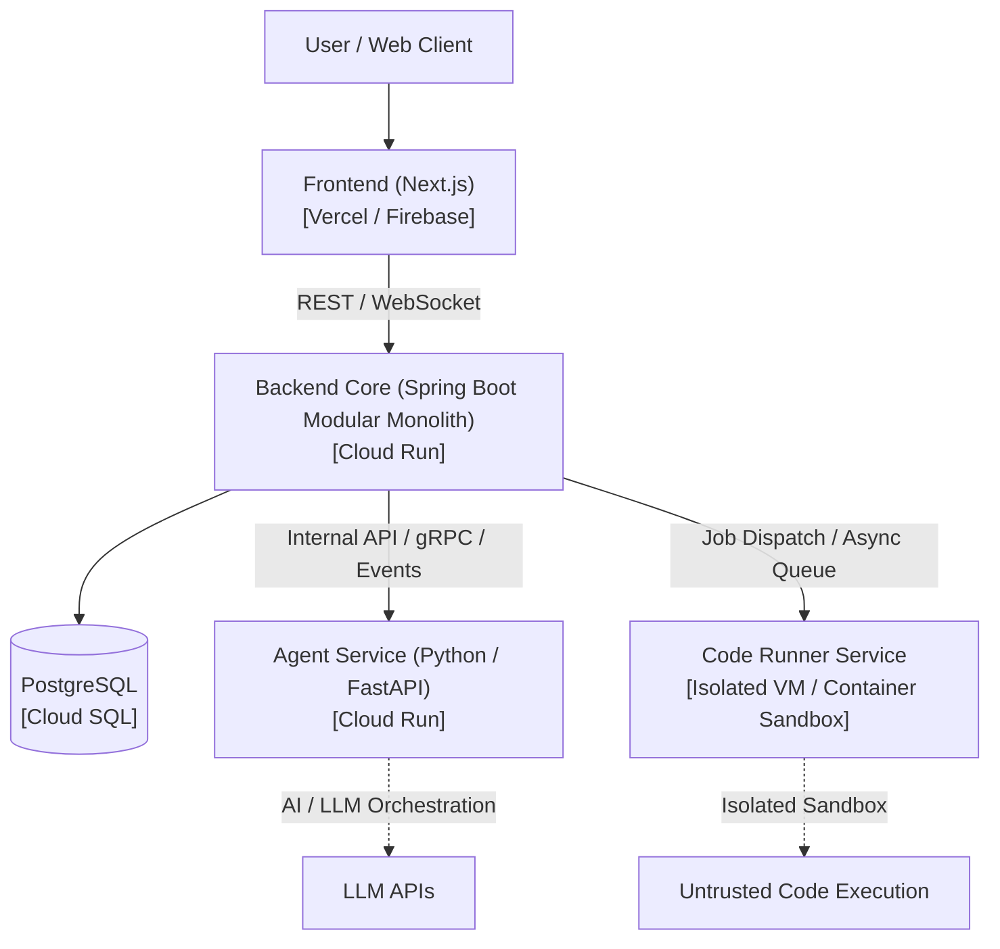

# Z365 Platform

A modern platform built with a **Monorepo** code organization, a **Modular Monolith** core API, and **Distributed Services** for resource-heavy and isolated workloads.

---

## 🏗️ Architecture Overview



### Strategy: Monorepo + Distributed Deployment
| Component | Tech Stack | Role | Initial Deployment Target |
| :--- | :--- | :--- | :--- |
| **`frontend/`** | Next.js, React, TailwindCSS | Web UI & Client Experience | Vercel / Firebase Hosting |
| **`backend/`** | Java 17+, Spring Boot 3 | Modular Monolith (Core API, Auth, Business Logic) | Google Cloud Run |
| **`agent-service/`** | Python 3, FastAPI | AI Agents, LLM pipelines, prompt workflows | Google Cloud Run |
| **`runner/`** | Execution Worker / Sandbox | Untrusted student/project code execution sandbox | Dedicated VM / GKE (isolated) |
| **`shared/`** | JSON Schemas / DTOs / Contracts | Shared interfaces and protocol definitions | Internal Monorepo |
| **`infra/`** | Docker Compose, Terraform / Cloud Run | Infrastructure as Code and local dev orchestration | Local / GCP |
| **`docs/`** | Markdown | Architecture design records, deployment guides | Monorepo Docs |

---

## 📁 Repository Structure

```text
z365/
├── frontend/          # Next.js web application
├── backend/           # Spring Boot modular monolith
├── agent-service/     # Python/FastAPI AI agent service
├── runner/            # Code and project execution workers (sandboxed)
├── shared/            # Shared DTOs, schemas, and API contracts
├── infra/             # Local Docker Compose & cloud deployment configs
└── docs/              # System architecture, deployment guides, and ADRs
```

---

## 🚀 Getting Started

See each folder's individual `README.md` for specific setup instructions, or start local dependencies via:

```bash
docker compose -f infra/docker-compose.yml up -d
```
